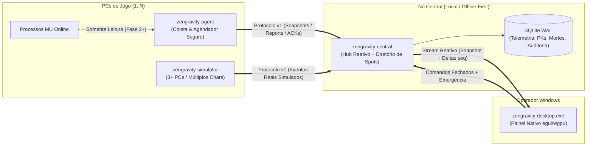

# Arquitetura do Sistema — ZenGravity

## 1. Visão Geral da Arquitetura

O **ZenGravity** é projetado como um workspace modular em **Rust**, onde toda regra de negócio é pura e determinística, toda comunicação entre processos utiliza contratos fortemente tipados e versionados, e a interface primária de operação é um **aplicativo desktop nativo do Windows (`zengravity-desktop.exe`)** acelerado por GPU (`egui`/`eframe` + `wgpu`).

---

## 2. Organização do Workspace e Responsabilidades dos Crates

| Crate | Caminho | Responsabilidade Principal | Dependências de SO / Rede |
|---|---|---|---|
| `zengravity-core` | `crates/core` | Domínio puro: modelos de mapas (`WorldId`), coordenadas e grid 256×256 (`Terrain`, A*), cálculo de `ZenTracker` (`Zen/h`, `ETA 2B`), máquina de alertas, avaliação de estados (`CharLifecycleState`), políticas de spots (`Directory`, espaçamento, leases), parsers de título e chat, relógio monotônico abstrato (`Clock`). | **Zero** (100% puro, sem I/O, sem Windows API, sem rede). |
| `zengravity-protocol` | `crates/protocol` | Contratos tipados e versionados (`PROTOCOL_VERSION = 1`): `MetricReading<T>` (valor, origem, timestamp, confiança), `AgentEnvelope`, `CentralEnvelope`, `PanelSnapshot`, `PanelDelta`, `Command` (lista fechada) e `CommandAck`. | Apenas `serde` e `zengravity-core`. |
| `zengravity-central` | `crates/central` | Hub reativo multi-PC: agrega relatórios de agentes, gerencia leases de spots sob exclusão mútua, detecta agentes ou leituras desatualizadas (`stale`), persiste histórico em SQLite (modo WAL) e publica `PanelSnapshot` + `PanelDelta` para clientes desktop conectados via WebSocket local ou canal em processo. | `tokio`, `axum`, `sqlx` (SQLite), `tracing`. |
| `zengravity-agent` | `crates/agent` | Esqueleto arquitetural do agente por PC: abstração `ObservationSource`, agendador de sessão única de entrada física por PC (`InputSessionScheduler`) com trava de emergência (`EmergencyStop`), fila priorizada de rotinas e cliente de conexão resiliente com reconexão exponencial. | `tokio`, `tracing` (leitores Win32 reais entram na Fase 2+). |
| `zengravity-simulator` | `crates/simulator` | Simulador reproduzível multi-PC (mínimo 3 PCs e múltiplos personagens): gera ciclos reais de telemetria (ganho de Zen, variações de HP, Dark Raven, movimentação em tiles, eventos de PK/Golden, queda de conexão e atraso/`stale`) e os envia para a Central usando exatamente o protocolo oficial. | `tokio`, `zengravity-core`, `zengravity-protocol`. |
| `zengravity-desktop` | `crates/desktop` | Aplicativo desktop nativo (`zengravity-desktop.exe`): interface escura profissional em `egui`/`eframe` (`wgpu`), cabeçalho com status da central e badge `MODO SIMULAÇÃO`, barra lateral, cards e tabela filtrável por PC/personagem, inspetor de detalhes com gráfico temporal, console de eventos/alertas e canvas de Mapa 2D interativo. | `eframe`, `egui`, `wgpu`, `tokio`. |
| `zengravity-test-support` | `crates/test-support` | Relógio simulado determinístico (`FakeClock`), construtores de fixtures e cenários de teste compartilhados entre os crates. | Apenas `zengravity-core` e `zengravity-protocol`. |

---

## 3. Fluxo de Dados, Confiabilidade e Tratamento de `Stale`

### 3.1 Metadados de Leitura (`MetricReading<T>`)
Nenhuma métrica crítica (Zen, HP, Posição, Helper, Pet HP, Entidades Próximas) trafega como um número solto sem contexto. No `zengravity-protocol`, toda leitura carrega:
- **`value`**: `Option<T>` (ausência de leitura é explícita: `None`, nunca `0` inventado);
- **`source`**: `MetricSource` (`RamLocked`, `ScreenOcr`, `ScreenPixelModel`, `ProcessTable`, `Simulator`, `Unknown`);
- **`observed_at_utc_ms`**: momento da coleta para auditoria;
- **`age_ms`**: idade monotônica calculada pela central/painel no momento da exibição;
- **`confidence`**: `Confidence` (`Verified`, `Provisional`, `Stale`, `Unavailable`).

### 3.2 Máquina de Estados do Personagem (`CharLifecycleState`)
A central e o painel determinam o estado verdadeiro do personagem seguindo uma hierarquia clara que impede falsos positivos:
1. **`Disconnected` (Desconectado / DC):** agente online, mas o cliente do jogo perdeu conexão TCP e os contadores de Zen/HP congelaram.
2. **`Stale` (Leitura Desatualizada):** o último relatório do agente ultrapassou `stale_after_s` (ex.: 12 s) ou a conexão do agente caiu. O painel destaca visualmente que os dados estão congelados no tempo e **não** dispara alertas falsos de `"PAROU"`.
3. **`Dead` (Morto):** HP confirmado em `0` ou evento de morte recente ainda não sucedido por HP > 0 estável.
4. **`Paused` (Pausado):** operador acionou parada manual (F8 / botão de emergência) ou pausou a automação do personagem/PC.
5. **`Recovering` (Recuperando):** personagem executando rotina de retorno ao spot, busca manual de spot ou deslocamento controlado.
6. **`Farming` (Farmando):** personagem online, vivo, perto do spot ativo (`<= ARRIVAL_RADIUS`), helper ligado e com leitura de Zen subindo dentro da janela ativa.
7. **`Stopped` (Parado):** personagem online e vivo, mas sem ganho de Zen por tempo `>= stopped_after_s` (e abaixo do limite de 2B) ou com Helper desligado fora de rotina.
8. **`Online`:** conectado e operacional, sem spot atribuído ou em cidade/zona segura sem rotina pendente.
9. **`Unknown` (Desconhecido):** processo detectado, porém ainda sem leitura inicial suficiente (ex.: janela na tela de seleção de personagem ou trava de RAM aguardando semente).

### 3.3 Protocolo Reativo (`Snapshot` + `Delta` + `Heartbeat`)
1. Quando o `zengravity-desktop` se conecta à `zengravity-central`, recebe imediatamente um `CentralToPanel::Snapshot` contendo o número de sequência `seq`, o modo da central (`simulation_mode: bool`), todos os PCs, personagens, diretório de spots, alertas ativos e últimos eventos.
2. A cada relatório de agente ou mudança de estado, a central incrementa `seq` e emite `CentralToPanel::Delta`, contendo apenas o estado atualizado do PC/personagem afetado, novos eventos e alertas alterados.
3. Um `Heartbeat` periódico confirma a vivacidade da conexão. Se o desktop detectar perda de conexão ou atraso acima do limite, exibe imediatamente o banner **`CONEXÃO COM A CENTRAL DESATUALIZADA (STALE) — RECONECTANDO...`** com backoff exponencial, sem congelar a thread gráfica.

---

## 4. Segurança, Permissões e Operação Offline

1. **Operação 100% Offline / Rede Local:**
   - O `zengravity-desktop.exe` não faz nenhuma requisição à internet. Fontes, ícones vetoriais e assets de terreno básico são embutidos no binário.
   - O banco SQLite (`zengravity.db`) reside localmente no diretório de dados configurado.
2. **Isolamento do Processo do Jogo:**
   - Nunca escrever na memória do jogo, nunca injetar DLLs, nunca interceptar pacotes.
   - Nunca abrir ou ler `Settings.ini` ou qualquer arquivo de credenciais do cliente.
3. **Agendador Físico Único por PC (`InputSessionScheduler`):**
   - Cada PC possui apenas um mouse e um teclado físicos. O módulo de agendamento do `zengravity-agent` garante por construção (mutex + token de sessão + verificação de `EmergencyStop`) que duas janelas jamais recebam comandos simultâneos e que uma requisição de parada de emergência cancele instantaneamente qualquer sessão ativa.
4. **Lista Fechada de Comandos (`Command`):**
   - O painel só pode emitir variantes enumeradas em `zengravity-protocol::Command` (`PauseAllAutomation`, `ResumeAllAutomation`, `SetMachineAutomation`, `SetCharAutomation`, `StartManualSpotSearch`, `CancelManualSpotSearch`, `ReturnToHomeSpot`, `AssignHomeSpot`, `ToggleSpotCatalogEntry`, `RelockTelemetry`, `TriggerEmergencyStop`).
   - Cada comando possui um `command_id: u64`, é registrado na tabela `audit` do SQLite e responde com `CommandAck { command_id, accepted, message }`.
